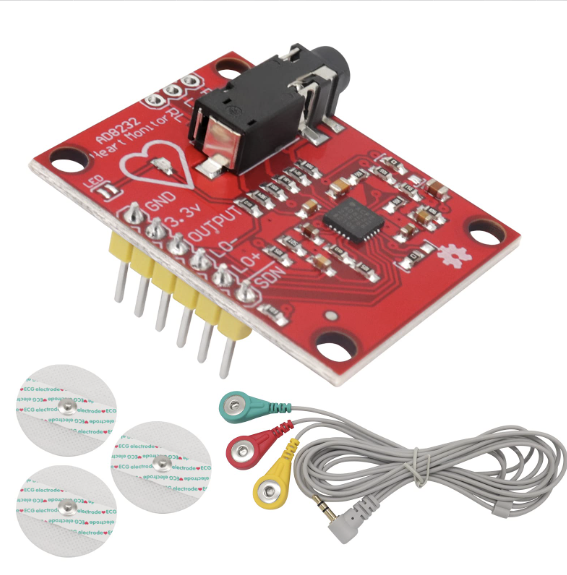

# ECG with Arduino Uno and AD8232

Aim: build an electrocardiogram (ECG) using an Arduino Uno and the AD8232 ECG heart rate monitor sensor.

  
    
  <em>Figure 1: Image of an AD8232</em>

## The ECG waveform

For each cardiac cycle, the ECG waveform shows four waves:
- P	the atria contract (depolarisation of the atria)
- QRS complex	the ventricles contract (depolarisation of the ventricles)
- T	the ventricles relax (repolarisation of the ventricles)
- U	not always visible; thought to come from the repolarisation of the Purkinje fibres or the end of ventricular relaxation

  
    
  <em>Figure 1: Expected ECG waveform for one cardiac cycle</em>

## Components
- Arduino Uno
- AD8232 ECG module (header pins soldered on)
- 3-lead electrode cable (3.5 mm jack)
- Disposable Ag/AgCl electrodes

The AD8232 measures the heart's electrical activity with three electrodes:

## Lead	Colour	Placement
- RA (right arm)	red	under the right clavicle
- LA (left arm)	yellow	under the left clavicle
- RL (right leg, reference)	green	bottom of the right side of the rib cage
  
## Wiring

| AD8232 pin	| Arduino Uno |
| --- | --- |
| GND	| GND |
| 3.3V	| 3.3V (not 5V)|
| OUTPUT | A0 |
| LO− |	pin 11 |
| LO+	| pin 10 |

**Safety : 
The laptop runs on battery only (charger unplugged) during every measurement, with no other mains-powered device connected to it.**

## How it works

### Power: 3.3 V
The Arduino supplies **3.3 V** and **GND** to the AD8232 board. This powers the chip,
which works at 3.3 V (5 V could damage it). The 3.3 V is not applied to the body:
the electrodes only **measure** the voltage produced by the heart, which is about 1 mV.

### The three electrodes
| Electrode | Colour | Role |
| --- | --- | --- |
| RA (right arm) | red | first measuring input |
| LA (left arm) | yellow | second measuring input |
| RL (right leg) | green | reference: the board uses it to cancel noise common to the whole body |

The AD8232 measures the **difference** between LA and RA. Noise that appears on both
electrodes at the same time cancels out, while the heart signal, which differs between
the two, remains. The board then amplifies this difference about 1000 times and filters it.

### The signals sent to the Arduino
| AD8232 pin | Arduino | What it carries |
| --- | --- | --- |
| OUTPUT | A0 | the amplified ECG signal, read by `analogRead(A0)` as a number from 0 to 1023 (0–5 V, 10-bit ADC) |
| LO− | pin 11 | "leads off" detection: goes HIGH when the RA electrode loses contact with the skin |
| LO+ | pin 10 | "leads off" detection: goes HIGH when the LA electrode loses contact with the skin |
| SDN | not connected | shutdown: pulled LOW, it puts the board in sleep mode to save power |

When LO+ or LO− is HIGH, the code sends 0 instead of the signal, so a bad
electrode contact is never mistaken for a heartbeat.
