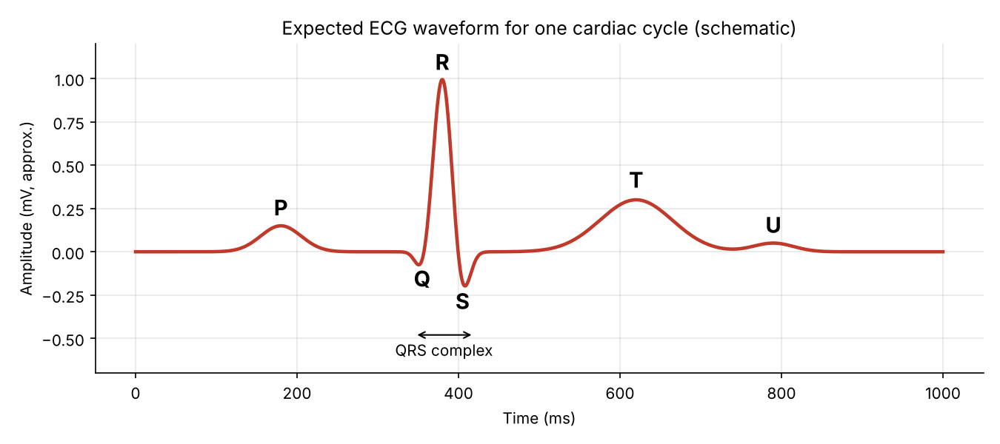

# ECG with Arduino Uno and AD8232

Aim: build an electrocardiogram (ECG) using an Arduino Uno and the AD8232 ECG heart rate monitor sensor.

## The ECG waveform

For each cardiac cycle, the ECG waveform shows four waves:
- P	the atria contract (depolarisation of the atria)
- QRS complex	the ventricles contract (depolarisation of the ventricles)
- T	the ventricles relax (repolarisation of the ventricles)
- U	not always visible; thought to come from the repolarisation of the Purkinje fibres or the end of ventricular relaxation

## Components
- Arduino Uno
- AD8232 ECG module (header pins soldered on)
- 3-lead electrode cable (3.5 mm jack)
- Disposable Ag/AgCl electrodes

The AD8232 measures the heart's electrical activity with three electrodes:

## Lead	Colour	Placement
- RA (right arm)	red	under the right clavicle
- LA (left arm)	yellow	under the left clavicle
- RL (right leg, reference)	green	bottom of the right side of the rib cage
  
## Wiring

| AD8232 pin	| Arduino Uno |
| --- | --- |
| GND	| GND |
| 3.3V	| 3.3V (not 5V)|
| OUTPUT | A0 |
| LO− |	pin 11 |
| LO+	| pin 10 |

**Safety : 
The laptop runs on battery only (charger unplugged) during every measurement, with no other mains-powered device connected to it.**
